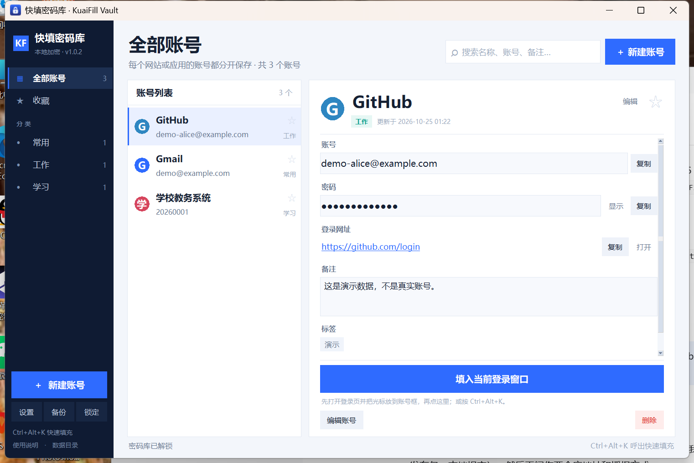
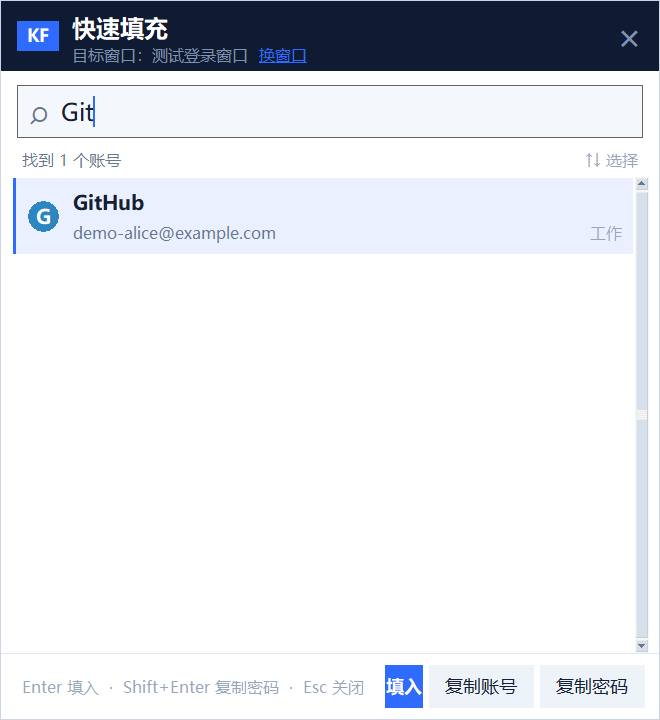

# 快填密码库（KuaiFill Vault）

一个只保存在本机的 Windows 账号密码库：账号和密码分开保存，登录时按一次快捷键，自动填入当前登录窗口。

- **AES-256-GCM** 加密 SQLite 数据库（Windows CNG，无第三方加密库）
- **scrypt + HKDF** 派生主密码密钥；数据库中没有明文网站名、账号、密码或备注
- 按“网站/应用 + 账号”区分多个账号，支持搜索、分类、标签、备注、收藏
- 默认 **Ctrl+Alt+K** 呼出快速填充：账号 → Tab → 密码
- 支持“主窗口 + 独立登录窗口”这类多窗口软件：按快捷键时记录真实输入焦点，填写前精确还原，可手动“换窗口”
- 皮肤中心（6 套配色）与窗口透明度可调
- 自动锁定、剪贴板定时清除、加密备份、修改主密码
- 完全离线，不联网、不上传





## 下载

- **Windows 便携版**：[release/KuaiFillVault-1.0.2-win64.zip](release/KuaiFillVault-1.0.2-win64.zip)  
  解压后双击 `启动快填密码库.bat` 或 `KuaiFillVault.exe`。
- **演示数据库**：[demo/demo-vault.db](demo/demo-vault.db)  
  演示主密码：`DemoOnly!2026`，内含 3 条虚构账号，**不要填入真实密码**。
- 校验值：[release/SHA256.txt](release/SHA256.txt)

> 仓库中包含的 exe/zip 和演示数据库是特意提供的下载文件；程序实际使用时会在 `data/vault.db` 新建你自己的加密数据库。

## 第一次使用

1. 解压 `KuaiFillVault-1.0.2-win64.zip` 到例如 `D:\工具\快填密码库\`（不要放 `C:\Program Files`）。
2. 双击 `启动快填密码库.bat`。
3. 设置主密码（至少 8 位，建议 12 位以上），勾选确认，创建密码库。
4. 点“＋ 新建账号”保存账号。

数据默认保存在程序目录：

```text
data/vault.db
```

## 快速填写

1. 打开要登录的网站或软件，把光标点进**账号框**。
2. 按 **Ctrl + Alt + K**。
3. 搜索账号，按 `↑` `↓` 选择，按 **Enter**。

程序会切回刚才的登录窗口，自动输入：

```text
账号 → Tab → 密码
```

默认**不会**自动按回车提交。遇到“先输账号、再点下一步”的网站，或 Tab 顺序不同的页面，请在详情页复制账号/密码后手动粘贴。

如果软件有两个窗口（主窗口 + 独立登录窗口），浮窗顶部会显示目标窗口，点旁边的“换窗口”可以改选。程序会记录按快捷键那一刻的输入焦点，填写前精确还原；确认不了焦点时会改为复制密码并提示，不会把密码打进别的窗口。浮窗底部还有“复制账号”“复制密码”两个按钮。

如果快捷键被占用，程序会尝试 `Ctrl+Shift+L`、`Ctrl+Alt+F9`；也可以到“设置”里改。

## 使用演示数据库

演示库包含 3 条虚构账号，主密码是公开的 `DemoOnly!2026`。两种打开方式：

```bat
:: 方式一：直接指定数据库路径
KuaiFillVault.exe --db demo\demo-vault.db

:: 方式二：先备份自己的 data\vault.db，再把演示库复制过去
copy demo\demo-vault.db data\vault.db
```

演示库只用于体验界面和快速填充，**不要在里面保存真实账号**。

## 安全设计

- 每条记录整体用 AES-256-GCM 加密，AAD 绑定记录 ID，换行/篡改会导致解密失败。
- 主密码用 scrypt（N=32768, r=8, p=1）+ HKDF-SHA256 派生，数据库只保存 salt 和 HMAC 校验值，不保存主密码。
- 默认 5 分钟无操作自动锁定，锁定后清空内存密钥和记录。
- 复制密码后默认 25 秒自动清除剪贴板。
- 备份文件同样加密，可复制到 U 盘或网盘。

### 它不能防什么

- 电脑已经被木马或键盘记录器控制；
- 解锁后离开电脑，别人直接操作；
- 你点错窗口，把密码填到了错误的地方；
- 主密码太弱，数据库文件被拿走后被离线暴力破解。

**主密码没有后门，忘记后无法找回。** 请记牢并定期备份 `data` 文件夹。

## 从源码运行

需要 Windows + Python 3.12 + Tkinter：

```bat
python app.py
```

运行测试：

```bat
python -m unittest discover -s tests -v
```

代码只使用 Python 标准库和 Windows 系统 API，不需要安装第三方运行库。

打包便携版（需要联网安装 PyInstaller）：

```powershell
powershell -ExecutionPolicy Bypass -File devtools/build_release.ps1
```

## 更新日志

### 1.0.2

- 新增权限校验：目标程序以管理员权限运行、或本程序被放在“低完整性”目录时，Windows 会静默丢弃模拟输入；现在会明确提示并改为复制密码，不再误报“已填入”。
- 建议把程序放在普通目录（桌面、文档、`D:\` 根目录下的文件夹）运行。

### 1.0.1

- 修复“主窗口 + 独立登录窗口”类软件提示已填入、实际没输入的问题：按快捷键时记录真实输入焦点，填写前精确还原，必要时在原位置补一次点击。
- 快速填充浮窗新增“换窗口”，可手动指定多窗口软件里的目标窗口。
- 浮窗新增“复制账号”按钮（在“复制密码”左边）。
- 设置里新增“皮肤中心”：6 套配色 + 窗口透明度（70%–100%），支持实时预览、取消还原。
- 焦点无法落到目标程序时不再盲目输入，改为复制密码并提示，避免把密码打进别的窗口。

### 1.0.0

- 首个版本：AES-256-GCM 加密库、全局快捷键快速填充、自动锁定、备份。

## 目录

```text
app.py                  程序入口
vault/
  crypto.py             AES-GCM / scrypt / HKDF
  db.py                 SQLite 加密存储
  autotype.py           全局快捷键 / SendInput / 目标窗口与焦点
  overlay.py            快速填充浮窗、换窗口、复制账号/密码
  dialogs.py            新建、设置（皮肤中心）、修改主密码
  ui.py                 主界面
  theme.py              配色、皮肤与控件
tests/                  自动化测试
devtools/               开发工具（双窗口测试程序、端到端驱动、打包脚本）
docs/screenshots/       界面截图
demo/demo-vault.db      演示密码库（公开演示密码）
release/                Windows 便携包
```

## 第三方组件

见 [第三方组件说明.md](第三方组件说明.md)。

本项目尚未添加开源许可证；如需 MIT/Apache-2.0 等许可证，请先补充 `LICENSE` 文件。
